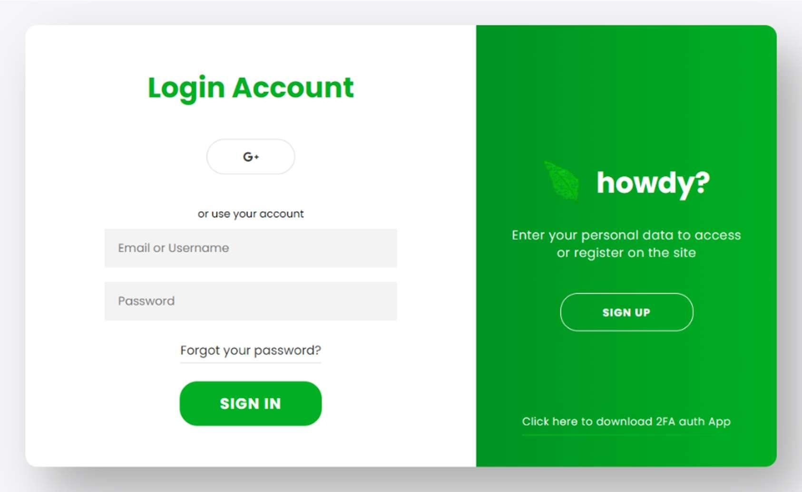
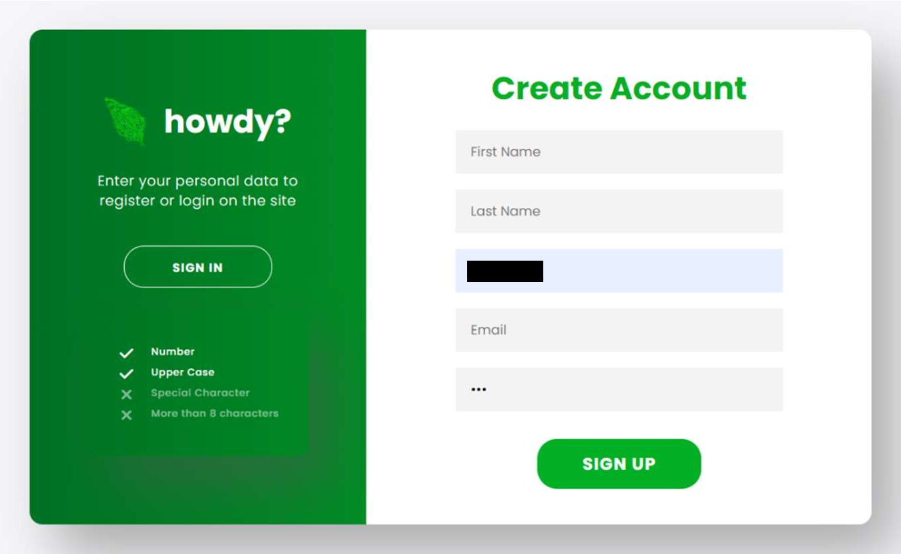
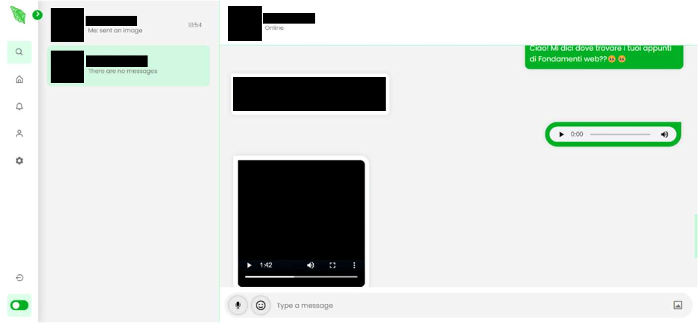
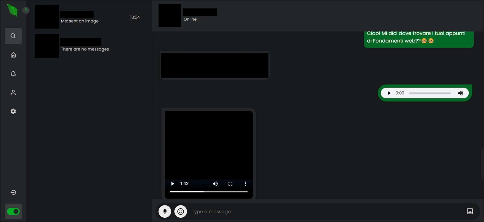
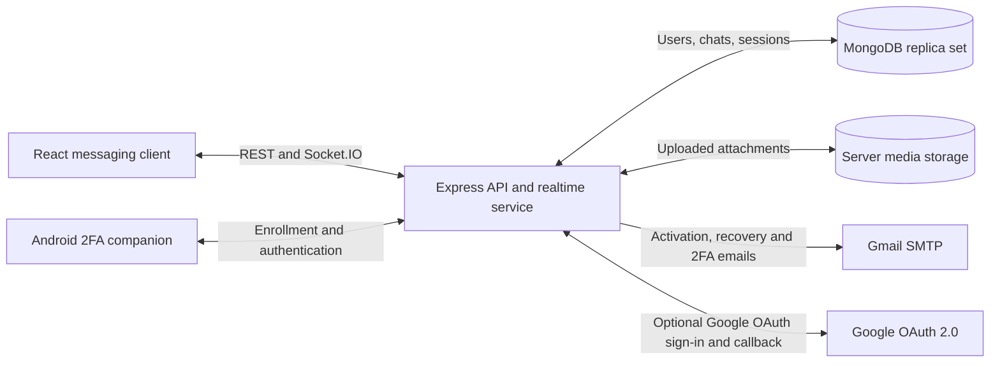

# howdy? — Real-Time Messaging Platform

**howdy?** is a full-stack messaging application combining a React web client, an Express/MongoDB API with Socket.IO, and an Android companion app for two-factor authentication (2FA).

Developed at **[Politecnico di Bari](https://www.poliba.it/en/ingegneria-informatica-e-dellautomazione)** as part of the **Bachelor's Degree in Computer and Automation Engineering**, for the *Software Engineering and Web Fundamentals* course (**Web Fundamentals module**, Academic Year **2022–2023**).

## Preview

The following screenshots illustrate selected representative features of the application and do not constitute an exhaustive overview of its interface.

The screenshots show the original academic web interface. Personal information and private conversation content have been redacted. The historical login screen shows an APK download link; the Android companion is now distributed as source code, as described in [Android Companion and 2FA](#android-companion-and-2fa).

### Authentication



*Web sign-in interface.*



*Account registration and password requirements.*

### Real-Time Messaging



*Light mode with the conversation list, message composer and multimedia controls.*



*The same conversation interface in dark mode.*

## Features

- Account registration, email activation, password recovery, and optional Google sign-in.
- One-to-one conversations with text, emoji, images, audio recordings, and video attachments.
- Real-time messages, typing indications, online presence, and notifications via Socket.IO.
- Contact search, friendship requests, user profiles, and interface theme preferences.
- Optional Android-based 2FA with email-verified device enrollment and rotating six-digit codes.
- Backend support for expiring Stories; a complete web Stories interface is not included.

## Technology Stack

| Component | Technologies |
| --- | --- |
| Web client | React 18, JavaScript/JSX, Create React App 5, Socket.IO client |
| API and real-time messaging | Node.js, Express 4, Socket.IO 4, Passport, JWT |
| Data persistence | MongoDB, Mongoose 7, MongoDB transactions |
| Identity and email | Gmail SMTP via Nodemailer, optional Google OAuth 2.0 |
| Android companion | Java, Android SDK, Android Gradle Plugin 7.3.1, Gradle 7.4, Android Keystore |

## Architecture



The web client communicates with the API over HTTP and Socket.IO. The Android companion handles the optional second factor; media are stored by the backend, and MongoDB transactions require a replica set.

## Repository Structure

```text
client/  # React web application
server/  # Express API, Mongoose models, Socket.IO handlers
  controllers/  # HTTP request handlers
  middleware/  # Authentication throttling
  socket_handlers/  # Real-time notifications
  tests/  # Node.js unit and regression tests
  howdy_cloud_storage/  # Default avatars; other media created at runtime
  scripts/  # Optional media backup and restore utilities
android/  # Android Studio / Gradle companion app
docs/  # Architecture and system behavior
  architecture.md  # System components and interactions
  images/  # Web interface screenshots
THIRD_PARTY_NOTICES.md  # Attribution and licensing of third-party materials
compose.yaml  # MongoDB replica set for local development
```

## Getting Started

### Prerequisites

- Node.js 22.x and npm 10.x (backend tests verified with Node.js 22.16.0 / npm 10.9.2); the included npm lockfiles use lockfile version 3. Use `npm ci` to install the locked dependencies.
- Docker Compose with MongoDB 7, or an existing MongoDB replica set. MongoDB transactions do not work against an ordinary standalone instance.
- A Gmail account configured for SMTP access (for example, with an appropriate app password) for activation, recovery and Android enrollment email.
- Google OAuth client credentials only if Google sign-in is required.
- For Android: Android Studio, an installed Android SDK (API 32), JDK 11, and the included Gradle wrapper.

### Run Locally

1. Start a local MongoDB replica set:

   ```bash
   docker compose up -d
   docker compose exec mongodb mongosh --eval 'rs.initiate({_id:"rs0",members:[{_id:0,host:"localhost:27017"}]})'
   ```

   Initialize the replica set **once** per new database volume. This sample has no database authentication and is intended only for local development.

2. Create your own local configuration files (not committed):

   ```bash
   cp server/.env.example server/.env
   cp client/.env.example client/.env
   ```

   Replace the secret placeholders with independently generated values. Configure `MONGODB_URI`, `BASE_URL`, `REACT_APP_DOMAIN`, `REACT_APP_API_BASE_URL`, `GMAIL_EMAIL`, and `GMAIL_PASSWORD`. The sample uses an API at `http://localhost:3000` and a web client at `http://localhost:3001`. `BASE_URL` and `REACT_APP_API_BASE_URL` must refer to the same API server. The email transport is configured specifically for Gmail SMTP (`smtp.gmail.com`); use Gmail credentials that permit SMTP access (typically an app password). Google sign-in is optional: leave both Google variables empty to disable it, or supply a Google OAuth client ID/secret and register `BASE_URL/auth/google/callback` as an authorized redirect URI.

3. Install and run the backend:

   ```bash
   cd server
   npm ci
   npm start
   ```

4. In a separate terminal, install and run the client:

   ```bash
   cd client
   npm ci
   npm start
   ```

   Create an account in the web interface and follow the email activation link before signing in. For local development, the MongoDB and API services must remain running while you use the web client.

## Android Companion and 2FA

Open `android/` in Android Studio to build the companion app. For an Android emulator, the default backend URL is already set to `http://10.0.2.2:3000`. From the repository root, create a command-line debug build with JDK 11 and Android SDK 32 installed (use `gradlew.bat` on Windows):

```bash
cd android
./gradlew assembleDebug
```

For an actual device, specify an HTTPS API URL reachable by that device, for example:

```bash
./gradlew assembleDebug -PhowdyBaseUrl=https://api.example.org
```

The resulting debug APK is located at `android/app/build/outputs/apk/debug/app-debug.apk`. Install it on a device or emulator through Android Studio, or with `adb install -r app/build/outputs/apk/debug/app-debug.apk`. No prebuilt APK is required: the companion app is distributed as source code.

The emulator address `10.0.2.2` resolves to the host development machine. Debug builds explicitly permit local cleartext HTTP; use HTTPS for real devices and release builds.

To activate 2FA, sign in to the Android app while no second factor is active, then complete the email enrollment challenge. The app stores its revocable device credential through Android Keystore and submits rotating six-digit codes. For subsequent browser sign-ins, the server verifies the account password, issues a **five-minute single-use login challenge**, and requires a current six-digit code. The client stores the challenge temporarily, not the password; accepting a code consumes it atomically. Repeated invalid codes temporarily lock the account.

The Android device must remain accessible to produce new codes. **Automated lost-device recovery and device migration are not implemented.** Google OAuth sign-in is unavailable for accounts that have enabled the Android second factor.

## Security and Operational Requirements

- Protected REST operations and Socket.IO handshakes validate the active JWT against the current database session. Authenticated Socket.IO events also revalidate that session; revocation disconnects active connections, including multiple tabs.
- Message attachments and conversation events enforce chat participation. Search and public profile responses do not expose other users' email addresses.
- Uploaded media are size-limited to 25 MiB and checked for allowed file extensions and basic container signatures. The server preserves original supported formats rather than changing extensions without converting the content. Browser playback of some video codecs is platform-dependent. These checks are **not** a substitute for malware scanning and safe media processing.
- Authentication, registration, device and enrollment endpoints have rate limits. A bounded in-memory limiter is available in development; production requires Redis at `REDIS_URL` for shared throttling. Production deployments also require HTTPS, secured MongoDB, a persistent `express-session` store, appropriate CORS configuration, monitoring, and independent security review.
- Profile images are available over public URLs by design. Replacing or removing a locally stored profile picture updates the database and removes the old file; external profile photos and default avatars are not deleted. Other uploaded media are access-controlled; deployment operators are responsible for privacy notices, data retention, backup consistency and access management.

## Tests

Run backend tests from the server directory:

```bash
cd server
npm ci
npm test
```

The Node.js test suite covers token operations, authentication challenges, 2FA code consumption, rate limiting, multi-tab connection registries, media-container validation, profile-picture replacement/removal, and OAuth helpers.

## Media Backup and Restore

Optional scripts transfer `server/howdy_cloud_storage` through [Magic Wormhole](https://magic-wormhole.readthedocs.io/) and `tar`. Install the `wormhole` command before running them, for example with `pipx install magic-wormhole` (requires Python and pipx). Keep the one-time transfer code private:

```bash
./server/scripts/backup.sh
./server/scripts/restore.sh
```

These tools transfer **media files only**, not MongoDB. Restoration stages and checks the received archive, then retains the previous directory for rollback. Stop the server before restoring and verify database/media consistency before deleting any retained backup. Only the supplied default avatars belong in the published source tree; keep user uploads, generated archives, local `.env` files, `node_modules`, and build output out of commits. Review staged files before every push (for example, with `git status` and `git diff --cached --name-only`).

## Documentation

The [architecture guide (English)](docs/architecture.md) documents components and interactions. Original attribution is retained in the [third-party notices (English)](THIRD_PARTY_NOTICES.md).

## Contributors

- [Cosimo Curri](https://github.com/cosimo-curri)
- [Giovanni Nardelli](https://github.com/narGiovanni)

## License and Third-Party Materials

The original project code is licensed under the [MIT License](LICENSE). Third-party materials remain subject to their respective licenses and terms.

Bundled Poppins fonts are covered by the SIL Open Font License 1.1; see [`android/licenses/Poppins-OFL.txt`](android/licenses/Poppins-OFL.txt). The GitHub Pages SPA routing script retains its upstream attribution and license in the [third-party notices](THIRD_PARTY_NOTICES.md). Dependency licenses remain with their respective packages. Verify any additional media or design assets against their original terms before redistribution.
